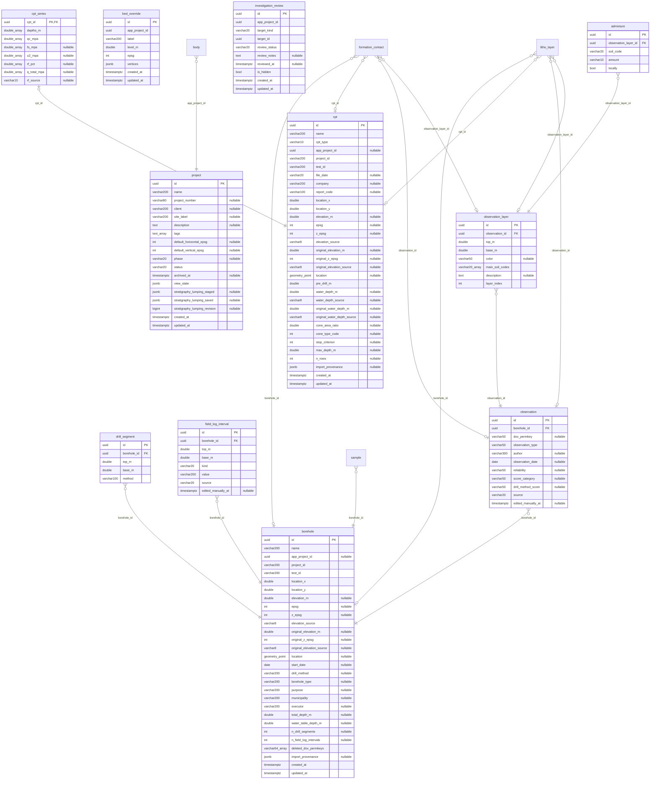
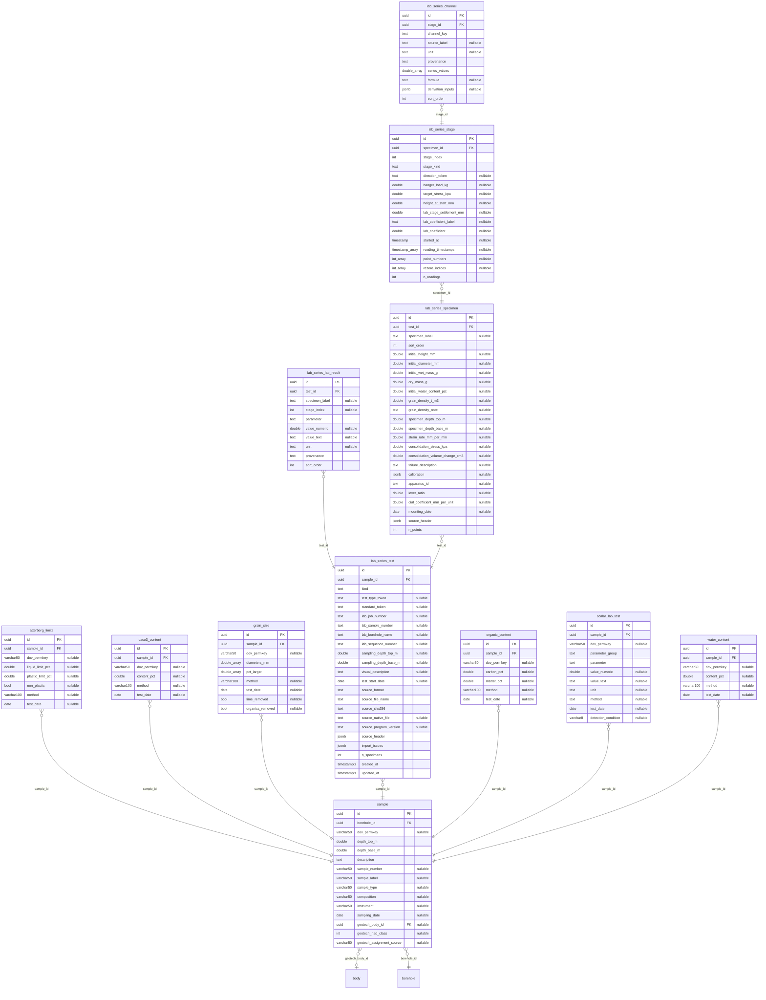
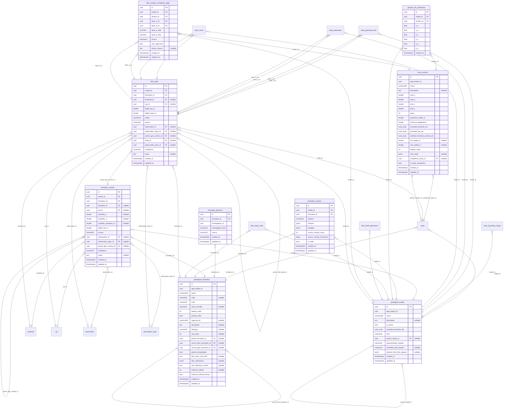
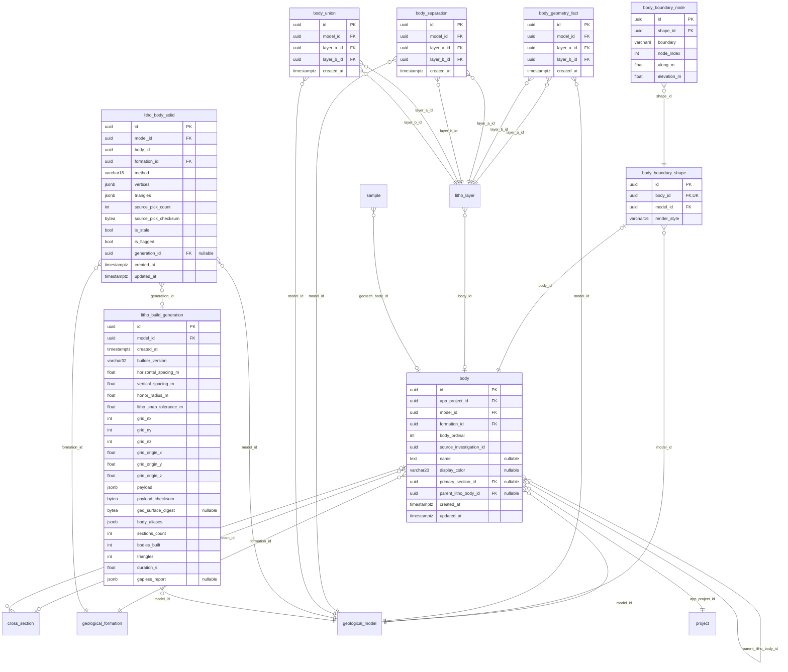

# Database ERD

<!-- Generated by scripts/gen_erd.py from the ORM metadata. Do not edit by hand. -->

Generated by `scripts/gen_erd.py` from the SQLAlchemy ORM metadata (`Base.metadata`). Do not edit by hand: regenerate with `uv run python scripts/gen_erd.py`. The unit test `tests/unit/docs/test_erd_up_to_date.py` fails when this file is stale.

Objects that exist only in migrations (partial unique indexes, triggers, check constraints) are not drawn. A relationship line reads `child <cardinality> parent : "fk column"` in standard crow's-foot notation: the child side is zero-or-many (`}o`), or zero-or-one (`|o`) when the FK column is unique; the parent side is exactly one (`||`) for a NOT NULL FK and zero-or-one (`o|`) for a nullable FK. A nullable column carries the comment `"nullable"`.

40 tables in 4 groups:

- Project and investigations: 11 tables
- Samples and lab tests: 12 tables
- Geological and litho interpretation: 9 tables
- Bodies and 3-D build: 8 tables

## Overview

```mermaid
erDiagram
    admixture
    atterberg_limits
    bed_override
    body
    body_boundary_node
    body_boundary_shape
    body_geometry_fact
    body_separation
    body_union
    borehole
    caco3_content
    cpt
    cpt_series
    cross_section
    drill_segment
    field_log_interval
    formation_absence
    formation_contact
    formation_surface
    geological_formation
    geological_model
    geotech_tie_tombstone
    grain_size
    investigation_review
    lab_series_channel
    lab_series_lab_result
    lab_series_specimen
    lab_series_stage
    lab_series_test
    litho_body_solid
    litho_build_generation
    litho_contact_correlation_edge
    litho_layer
    observation
    observation_layer
    organic_content
    project
    sample
    scalar_lab_test
    water_content
    admixture }o--|| observation_layer : "observation_layer_id"
    atterberg_limits }o--|| sample : "sample_id"
    body }o--|| project : "app_project_id"
    body }o--|| geological_formation : "formation_id"
    body }o--|| geological_model : "model_id"
    body }o--o| body : "parent_litho_body_id"
    body }o--o| cross_section : "primary_section_id"
    body_boundary_node }o--|| body_boundary_shape : "shape_id"
    body_boundary_shape |o--|| body : "body_id"
    body_boundary_shape }o--|| geological_model : "model_id"
    body_geometry_fact }o--|| litho_layer : "layer_a_id"
    body_geometry_fact }o--|| litho_layer : "layer_b_id"
    body_geometry_fact }o--|| geological_model : "model_id"
    body_separation }o--|| litho_layer : "layer_a_id"
    body_separation }o--|| litho_layer : "layer_b_id"
    body_separation }o--|| geological_model : "model_id"
    body_union }o--|| litho_layer : "layer_a_id"
    body_union }o--|| litho_layer : "layer_b_id"
    body_union }o--|| geological_model : "model_id"
    caco3_content }o--|| sample : "sample_id"
    cpt_series |o--|| cpt : "cpt_id"
    cross_section }o--o| body : "companion_body_id"
    drill_segment }o--|| borehole : "borehole_id"
    field_log_interval }o--|| borehole : "borehole_id"
    formation_absence }o--|| geological_formation : "formation_id"
    formation_contact }o--o| borehole : "borehole_id"
    formation_contact }o--o| cpt : "cpt_id"
    formation_contact }o--|| geological_formation : "formation_id"
    formation_contact }o--|| geological_model : "model_id"
    formation_contact }o--o| observation : "observation_id"
    formation_contact }o--o| observation_layer : "observation_layer_id"
    formation_contact }o--o| formation_contact : "parent_geo_contact_id"
    formation_surface }o--|| geological_formation : "formation_id"
    formation_surface }o--|| geological_model : "model_id"
    geological_formation }o--o| geological_formation : "parent_formation_id"
    geological_formation }o--o| geological_formation : "source_geo_formation_id"
    geological_formation }o--o| geological_formation : "source_litho_formation_id"
    geological_model }o--o| geological_model : "parent_model_id"
    geotech_tie_tombstone }o--|| geological_model : "model_id"
    geotech_tie_tombstone }o--|| cross_section : "section_id"
    grain_size }o--|| sample : "sample_id"
    lab_series_channel }o--|| lab_series_stage : "stage_id"
    lab_series_lab_result }o--|| lab_series_test : "test_id"
    lab_series_specimen }o--|| lab_series_test : "test_id"
    lab_series_stage }o--|| lab_series_specimen : "specimen_id"
    lab_series_test }o--|| sample : "sample_id"
    litho_body_solid }o--|| geological_formation : "formation_id"
    litho_body_solid }o--o| litho_build_generation : "generation_id"
    litho_body_solid }o--|| geological_model : "model_id"
    litho_build_generation }o--|| geological_model : "model_id"
    litho_contact_correlation_edge }o--|| litho_layer : "layer_a_id"
    litho_contact_correlation_edge }o--|| litho_layer : "layer_b_id"
    litho_contact_correlation_edge }o--|| geological_model : "model_id"
    litho_contact_correlation_edge }o--|| cross_section : "section_id"
    litho_layer }o--o| body : "body_id"
    litho_layer }o--o| borehole : "borehole_id"
    litho_layer }o--o| cpt : "cpt_id"
    litho_layer }o--|| geological_formation : "formation_id"
    litho_layer }o--|| geological_model : "model_id"
    litho_layer }o--o| observation : "observation_id"
    litho_layer }o--o| observation_layer : "observation_layer_id"
    litho_layer }o--o| formation_contact : "parent_geo_contact_id"
    litho_layer }o--o| litho_layer : "parent_litho_layer_id"
    observation }o--|| borehole : "borehole_id"
    observation_layer }o--|| observation : "observation_id"
    organic_content }o--|| sample : "sample_id"
    sample }o--|| borehole : "borehole_id"
    sample }o--o| body : "geotech_body_id"
    scalar_lab_test }o--|| sample : "sample_id"
    water_content }o--|| sample : "sample_id"
```

## Project and investigations

## Samples and lab tests

## Geological and litho interpretation

## Bodies and 3-D build

