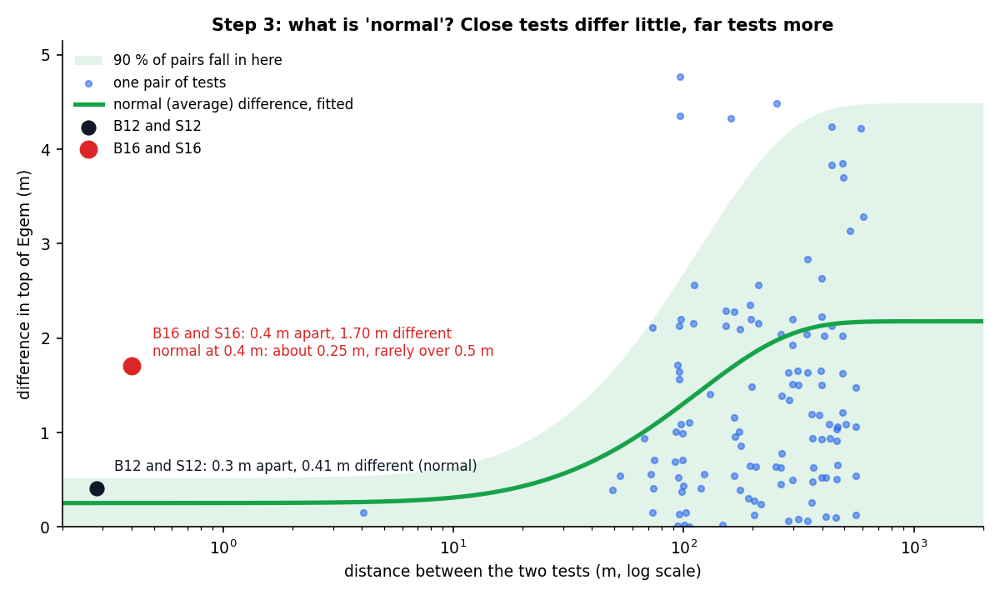
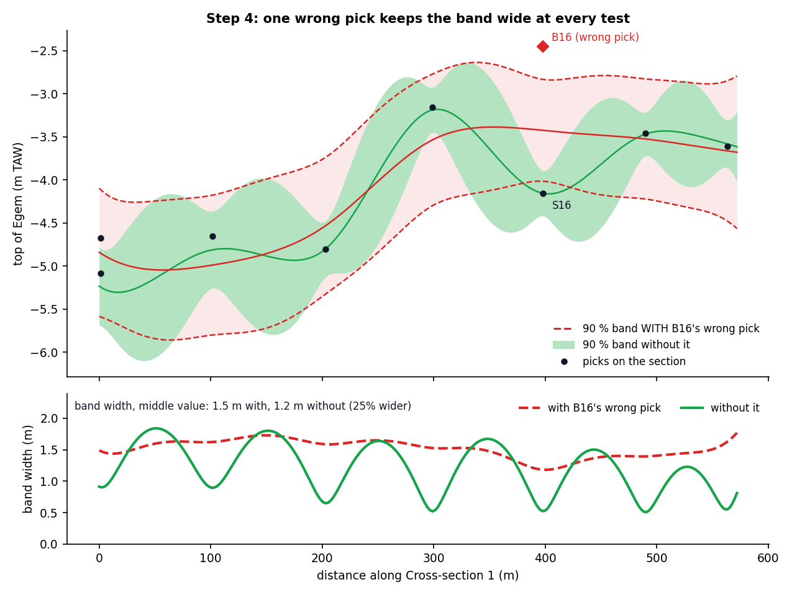

Methods and correlations
========================

This chapter documents **how StrixGeo computes every derived value**. For each
method you will find the equation, its symbols and units, the published
reference, and the plain condition under which the method applies. A short worked
example is given for each, as an illustration of the numbers involved.

Everything in this chapter is **characterisation**: the soil-behaviour
classification, the relative density and the packing class. The characteristic
soil parameters (dry and wet unit weight, effective friction angle, effective
cohesion, undrained shear strength) are not computed by a correlation here; they
are read straight from the Belgian NAD table for a unit's class, and are covered
in the NAD section. The design checks that consume any of this run in your
downstream tool.

.. admonition:: Correlations can carry errors

   Every correlation below is empirical and soil-dependent. StrixGeo has taken
   care with each, but a correlation can still be a poor fit for a particular
   soil, and mistakes in an implementation are always possible. If a value looks
   wrong for the ground you know, treat your judgement as the authority, and let
   us know so we can check it.

.. admonition:: A note on qc against qt

   The published Robertson expressions are written with the pore-pressure
   corrected cone resistance qt. StrixGeo uses the recorded cone resistance qc
   directly in the unit-weight, normalised-parameter and index expressions, and
   does not substitute qt even when a piezocone records the pore pressure. For
   sands, and for cones without reliable pore pressure, the two are practically
   equal; in soft fine soils with high excess pore pressure they differ. Using
   raw qc is a deliberate decision for this version, and it matches how the NAD
   classes are assigned for shallow soils. Using qt where the pore pressure is
   measured is future work.

Unit weight from CPT
--------------------

StrixGeo estimates the bulk unit weight of the soil at each cone reading, which
it then integrates into the stress profile.

.. math::

   \gamma = 9.81 \left( 0.27 \, \log_{10} R_f + 0.36 \, \log_{10}\!\frac{q_c}{0.1} + 1.236 \right)

where

.. math::

   R_f = \frac{f_s}{q_c} \times 100 .

Symbols and units:

* :math:`\gamma`, bulk unit weight (kN/m³);
* :math:`q_c`, cone resistance (MPa);
* :math:`f_s`, sleeve friction (MPa);
* :math:`R_f`, friction ratio (%).

The constant 0.1 is atmospheric pressure in MPa, so :math:`q_c/0.1` is
dimensionless, and 9.81 is the unit weight of water in kN/m³.

**Reference.** Robertson & Cabal (2015). The value applies where qc, fs and Rf
are all positive; where a reading is not, its unit weight is left out and filled
from the next valid reading below, so a short gap never breaks the integration.

*Example.* For qc = 12 MPa and fs = 0.08 MPa (so Rf = 0.667 %), the unit weight is
about 19.0 kN/m³.

The stress profile
------------------

From the per-reading unit weights StrixGeo integrates the vertical stress down
the column. The step is the actual depth increment between successive readings,
using the trapezoidal average of the two bounding unit weights.

.. math::

   \sigma_{v,k} = \sigma_{v,k-1} + \tfrac{1}{2}\left( \gamma_{k-1} + \gamma_k \right)\,\Delta z_k

The pore water pressure below the water table is

.. math::

   u_k = \gamma_w \, (z_{w} - z_k)

and the effective vertical stress is the total stress less the pore pressure,
floored just above zero:

.. math::

   \sigma'_{v,k} = \max\!\left( \sigma_{v,k} - u_k,\; 0.001 \right).

Symbols and units:

* :math:`\sigma_v`, total vertical stress (kPa);
* :math:`\sigma'_v`, effective vertical stress (kPa);
* :math:`u`, pore water pressure (kPa);
* :math:`\gamma_k`, bulk unit weight at reading k (kN/m³);
* :math:`\gamma_w`, unit weight of water (default 9.81 kN/m³);
* :math:`\Delta z_k`, depth increment (m);
* :math:`z_w`, water-table elevation, and :math:`z_k`, reading elevation (m TAW).

The principle behind this is Terzaghi's effective-stress principle: the effective
stress that governs soil behaviour is the total stress carried by the soil
skeleton, less the pore water pressure. The profile handles the water table at or
above the surface (saturated from the top), between the surface and the first
reading (an unsaturated unit weight, default 16 kN/m³, above the water table), or
below the first reading. The effective stress is floored just above zero because
the normalisation that consumes it divides by it, and near-surface points above
the water table can otherwise reach zero. Where a CPT records no water table,
StrixGeo assumes water at the ground surface, which is the conservative choice and
is applied to every consumer of the profile identically.

**Reference.** Terzaghi, Peck & Mesri (1996); Verruijt (2001).

*Example.* At 8 m depth in a sand column (ground at 10 m TAW, water table 2 m
deep) the total vertical stress is about 147 kPa, the pore pressure about 59 kPa,
so the effective vertical stress is about 88 kPa.

Normalised cone parameters and the stress exponent
--------------------------------------------------

This is the normalised soil-behaviour-type index. It iterates, because the stress
exponent depends on the very index it helps compute.

.. math::

   Q_{tn} = \frac{q_c \cdot 1000 - \sigma_v}{100}\left(\frac{100}{\sigma'_v}\right)^{\! n}

.. math::

   F_r = \frac{f_s \cdot 100000}{q_c \cdot 1000 - \sigma_v}

.. math::

   I_c = \sqrt{\left(3.47 - \log_{10} Q_{tn}\right)^2 + \left(\log_{10} F_r + 1.22\right)^2}

.. math::

   n = 0.381\,I_c + 0.05\,\frac{\sigma'_v}{100} - 0.15 \qquad (0 < n \le 1)

The exponent is kept between 0 and 1: a computed value above 1 is used as 1,
and a value at or below 0 as the smallest positive step, as in Robertson
(2009).

Symbols and units:

* :math:`Q_{tn}`, normalised cone resistance (dimensionless);
* :math:`F_r`, normalised friction ratio (%);
* :math:`I_c`, soil-behaviour-type index (dimensionless);
* :math:`n`, stress exponent (between 0 and 1);
* :math:`q_c`, :math:`f_s` (MPa); :math:`\sigma_v`, :math:`\sigma'_v` (kPa).

The factors 1000 convert MPa to kPa; the 100 values are atmospheric pressure in
kPa; the net cone resistance is :math:`q_c\cdot1000 - \sigma_v` in kPa. StrixGeo
starts from n = 1, computes the index, updates n, and repeats until n changes by
less than 0.002 between passes (a handful of passes for any real CPT).

**Reference.** Robertson (2009). A reading is skipped very near the surface, where
the overburden exceeds the cone resistance (which would make the logarithm
undefined), or where the friction ratio is not positive.

*Example.* At the 8 m sand reading above, :math:`Q_{tn} \approx 127`,
:math:`F_r \approx 0.67\,\%`, :math:`I_c \approx 1.72`, with n converging near
0.55.

Soil-behaviour-type zones and the peat boundary
-----------------------------------------------

The converged normalised pair is placed on the Robertson soil-behaviour-type
chart, which is divided into nine zones by boundary lines. StrixGeo stores each
boundary and reads off the zone by interpolation:

.. math::

   Z_i(F_r) = 10^{\,\operatorname{interp}\left(\log_{10} F_r,\; X_i,\; Y_i\right)}

A reading whose normalised resistance exceeds a boundary sits in the
higher-numbered zone. The nine zones run from 1 (sensitive fine-grained) through
6 (clean sand to silty sand) to 9 (very stiff fine-grained), with 2 for organic
soil and peat. The organic and peat boundary is an extension of the chart:

.. math::

   Z_8 = \begin{cases} 0 & F_r \le 5.2 \\ 8\,(F_r - 5.2)^{0.5} & F_r > 5.2 \end{cases}

Symbols and units:

* :math:`Z_i`, the boundary value of the normalised resistance for zone i
  (dimensionless);
* :math:`F_r`, normalised friction ratio (%);
* :math:`X_i, Y_i`, the stored knots of boundary i.

The zone drives a **lithology suggestion** through a fixed lookup: zones 1, 3 and
9 give clay, zone 2 gives peat, zones 4 and 5 give silt, zones 6, 7 and 8 give
sand. Gravel is deliberately not read from the CPT, because the standard chart
cannot separate gravel from dense sand reliably; gravel is confirmed from a
borehole.

**Reference.** Robertson (2009) and Robertson & Cabal (2015) for the chart and its
zones; the peat boundary is Lengkeek & Brinkgreve (2022).

*Example.* The 8 m sand reading lands in zone 6 (clean sand to silty sand), which
maps to sand.

The non-normalised index
------------------------

When the effective-stress profile is unreliable (shallow depth, made ground, an
unknown water table), the normalised index is unreliable too, because it depends
on that profile. StrixGeo then offers the **non-normalised** index, which reads
the cone resistance and friction ratio directly with no stress profile and no
iteration:

.. math::

   I_{SBT} = \sqrt{\left(3.47 - \log_{10}\frac{q_c}{p_a}\right)^2 + \left(\log_{10} R_f + 1.22\right)^2}

Symbols and units:

* :math:`I_{SBT}`, non-normalised index (dimensionless);
* :math:`q_c`, cone resistance (MPa);
* :math:`p_a`, atmospheric reference pressure (0.1 MPa);
* :math:`R_f`, friction ratio (%).

The index is banded into the same zones the normalised index uses:
below 1.31 is zone 7, 1.31 to 2.05 is zone 6, 2.05 to 2.60 is zone 5, 2.60 to
2.95 is zone 4, 2.95 to 3.60 is zone 3, and 3.60 and above is zone 2.

**Reference.** Robertson & Cabal (2015). The value applies where qc, fs and Rf are
all positive.

*Example.* For qc = 12 MPa and fs = 0.08 MPa, :math:`I_{SBT} \approx 1.74`, which
is zone 6 (clean sand to silty sand), the same zone the normalised path gives.

Relative density of clean sand
------------------------------

For clean sands StrixGeo estimates the relative density from the cone resistance
and the effective stress.

.. math::

   D_r = 100 \left( 0.268 \, \ln\!\frac{q_c/0.1}{\left(\sigma'_v/100\right)^{0.5}} - C \right)

Symbols and units:

* :math:`D_r`, relative density (%);
* :math:`q_c`, cone resistance (MPa);
* :math:`\sigma'_v`, effective vertical stress (kPa);
* :math:`C`, the compressibility factor (default 0.675 for quartz sand; 0.525 for
  high-compressibility calcareous sand; 0.825 for low-compressibility quartz
  sand).

The 0.1 is atmospheric pressure in MPa and the 100 under the root is atmospheric
pressure in kPa, so both ratios are dimensionless.

**Reference.** Jamiolkowski, lo Presti & Manassero (2003), as tabulated in
Robertson & Cabal (2015). This applies only to clean sand, defined as :math:`I_c`
below 2.45 and :math:`R_f` below 1.2; other soils get no relative density. The
relative density is banded into a descriptor for sand, loose below 35 %, medium
dense from 35 to 65 %, dense from 65 to 85 %, and very dense above 85 %.

*Example.* For qc = 12 MPa and an effective stress of about 88 kPa, with the
default compressibility factor, :math:`D_r \approx 63\,\%`.

NAD packing classes
-------------------

The geotechnical stage assigns each unit a **Belgian NAD class** by looking up a
representative cone resistance against the class's qc band for the unit's soil and
admixture variant. The lookup is on raw qc, in megapascals, with no
normalisation, which is the NAD table's own method.

The readings inside a body are reduced to one **representative qc** by a
selectable statistic: the median (the default, robust to spikes), or the
arithmetic, harmonic or geometric mean. For the same positive readings these order
as harmonic, then geometric, then arithmetic, so the choice shifts the class
systematically; the harmonic mean is the conservative choice. That representative
qc is walked against the bands for the unit's soil column, and the first band it
falls in gives the class.

.. list-table:: NAD qc bands (classes 1 to 31), qc in MPa
   :header-rows: 1
   :widths: 24 20 16 40

   * - Soil and variant
     - Band (qc)
     - Class
     - Packing
   * - gravel, clean
     - < 20 / ≥ 20
     - 1 / 2
     - matig / dicht
   * - gravel, with admixture
     - < 20 / ≥ 20
     - 3 / 4
     - matig / dicht
   * - sand, clean
     - < 4 / 4 to 10 / 10 to 15 / ≥ 15
     - 5 / 6 / 7 / 8
     - los / matig / dicht / zeer dicht
   * - sand, with admixture
     - < 4 / 4 to 10 / 10 to 15 / ≥ 15
     - 9 / 10 / 11 / 12
     - los / matig / dicht / zeer dicht
   * - silt, clean
     - < 1 / 1 to 2 / 2 to 4 / ≥ 4
     - 13 / 14 / 15 / 16
     - weinig-vast / matig-vast / vrij-vast / vast
   * - silt, with admixture
     - < 1 / 1 to 2 / 2 to 4 / ≥ 4
     - 17 / 18 / 19 / 20
     - weinig-vast / matig-vast / vrij-vast / vast
   * - clay, clean
     - < 1 / 1 to 2 / 2 to 4 / ≥ 4
     - 21 / 22 / 23 / 24
     - weinig-vast / matig-vast / vrij-vast / vast
   * - clay, with admixture
     - < 1 / 1 to 2 / 2 to 4 / ≥ 4
     - 25 / 26 / 27 / 28
     - weinig-vast / matig-vast / vrij-vast / vast
   * - peat
     - < 0.5 / 0.5 to 1 / ≥ 1
     - 29 / 30 / 31
     - weinig-vast / matig-vast / vast

The band bottoms are open: because the soil type is already fixed by the litho
model, a reading below the printed floor still belongs to that soil and takes its
loosest class. The clean column is for a pure soil; the with-admixture column is
for a soil carrying its one NAD admixture variant (a clay or silt admixture in a
sand or gravel, a sand admixture in a fine soil). A gravel admixture in a sand is
not a NAD variant, so a gravelly sand classifies as clean sand.

Besides the packing class, the NAD table also carries the **characteristic soil
parameters** for each class: the dry and wet unit weight, the effective friction
angle, the effective cohesion, and, for the fine soils, the undrained shear
strength. StrixGeo reads these straight from the table, one general value per
body, and shows them in the Parameters stage.

**Reference.** The NAD packing-class table of NBN EN 1997-1 ANB (the Belgian
national annex to Eurocode 7), Tabel 2.1. A missing, non-numeric or negative qc is
rejected rather than mapped to a class; a genuine measured 0.0 is valid and takes
the loosest class. A unit with no cone reading gets no machine class from qc
alone; a borehole is instead classified from the surrounding CPTs, as the Geotech
chapter describes.

*Example.* Clean sand at a representative qc of 12 MPa is class 7 (dicht); at 8
MPa it is class 6 (matig). Clean clay at 1.5 MPa is class 22 (matig-vast).

Litho segmentation
------------------

The litho segmenter is **StrixGeo's own algorithm**, built on the
soil-behaviour-type zones above. It turns a per-reading zone sequence into a small
set of suggested layers in five steps:

#. classify each reading into a zone (the normalised path, or the non-normalised
   path where the stress profile is unreliable);
#. smooth the zone sequence with a rolling median whose half-window is sized to
   the minimum layer thickness;
#. group the smoothed sequence into runs of one zone;
#. merge any run thinner than the minimum layer thickness into its neighbour,
   rescanning until every run meets the threshold;
#. emit one layer per surviving run, mapping its dominant zone to a lithology.

The half-window of the smoothing median is

.. math::

   \text{half-window} = \max\!\left(1,\; \operatorname{round}\!\left(\frac{t_{\min}/2}{\Delta z}\right)\right)

readings above and below each point, for a total window of twice that plus one.

Symbols and units:

* :math:`t_{\min}`, minimum layer thickness (m, default 0.15, tunable per
  project);
* :math:`\Delta z`, the mean depth increment of the series (m).

The median is robust to single-reading spikes (thin interbeds) and preserves sharp
transitions better than a mean. Each suggested layer carries a confidence: high
when it is at least twice the minimum thickness, medium when it just meets it, low
when it survived only by a merge. For a borehole there is no cone reading, so each
observed layer's soil code maps to a base lithology and the same merge is applied.
The layer partition is contiguous: each layer's base is the next layer's top, so
a set of accepted contacts leaves no gap.

The 2 / 1 / 0 fill rule
-----------------------

The interpreted geometry of a section is a **partition** of bands, onlaps and
lenses produced by one rule (introduced in the Litho chapter). A unit's shape
toward a neighbour depends purely on how many of its two bounding contacts are
correlated to that neighbour:

* **two correlated**, a band: the unit is a continuous band between the two
  tests;
* **one correlated**, an onlap: the unit is flat on the correlated bracket and
  pinches to a tip toward the neighbour (up if the top is tied, down if the base);
* **none correlated**, a lens: the unit is a lens with a horizontal apex at its
  own elevation, closing off between the tests.

The rule is applied per gap and per side (a unit can band one way and pinch the
other), and there is no automatic facies inference: two mismatched units meet at a
straight seam unless you draw the facies contact yourself. Below a shallow test's
total depth, the deeper stratigraphy runs as straight deep-to-deep bands, so the
deep model stays continuous even where a shallow test does not reach it. In the
geotech stage the same rule draws the packing bands. This partition is the single
source of truth for the interpreted geometry: the 2-D drawing, the 3-D build and
every geometry export all derive from it.

Bodies: identity is geometry
----------------------------

A **body** is the maximal set of same-lithology layers joined, directly or
through their neighbours, by approved correlations and observed adjacencies.
StrixGeo stamps each connected mass with one body identity. The identity says
which mass, not what shape; the shape comes from the partition above. A body's
user state (its name, colour and hand-drawn boundary) follows the mass across a
renumber. When you Join bodies into a group, every body keeps its own identity and
the group is a label carried on each member, because a group can span two litho
parents and merging would lose that provenance. A group exports as one class.

The voxel labelling
-------------------

The 3-D build does not create new geometry; it **labels space** from the 2-D
partition. StrixGeo lays a grid of small boxes over the modelled volume (bounded
by the formation surfaces and floored at the deepest investigation) and decides
each box's unit by mapping its position back onto the section partitions, using
the same fraction-to-metres mapping the 2-D fill and the closed-geometry export
use, so the solid, the sections and the export describe the same ground. Between
two sections the box takes a distance-weighted blend of the two nearest sections'
stacks, a body present on both carrying across and a body present on only one
pinching out; beyond the nearest pair the nearest section that has material is
carried outward. At an investigation the box is labelled from that investigation's
own accepted log. A meshing step then extracts a renderable surface from the grid.

Unit statistics
---------------

The Parameters stage describes each unit's measured spread. For a unit, StrixGeo
pools **every finite CPT reading that falls inside the unit's bands**, across all
the CPTs the unit stands on, in the depth frame metres below the collar. It
summarises three channels independently, each on its own axis: cone resistance qc
(MPa), sleeve friction fs (MPa) and friction ratio Rf (%). For each channel it
reports the count of finite samples and, when the count supports them, the
five-number summary (minimum, 5th percentile, first quartile, median, third
quartile, 95th percentile, maximum), the arithmetic mean, and the sample standard
deviation (n minus 1). Any statistic the sample count cannot support is reported
blank, never zero: an empty unit has no median, and a single reading has no
standard deviation. These are descriptive statistics of measurements, with no
correlation, conversion or calibration into a design value.

Export mapping
--------------

Every export identifies a unit by a token built from its NAD class and soil code
(for example a class-6 sand becomes ``NAD-06_ZAND``, a formation gets no token).
Because a group is a set of separate bodies sharing a label, the export maps the
whole group to one class. The class is zero-padded so that text-sorting material
lists keep the classes in order, and it leads the token so a wildcard selects
every instance of a class. The D-Series exporters attach the characteristic unit
weight, friction angle and cohesion only where the NAD table has a row for the
class, and write no other design parameter.

Pick consistency check
----------------------

StrixGeo checks every pick of a geological model against its neighbours. The
check runs always, in the background, after every change to the picks. A pick
that does not fit gets a flag in the Geology inspector of the Stratigraphy stage,
for example "1 pick to check". The check never changes a pick. You decide.

**Which picks are checked.** Only picks on tests that a cross-section draws. These
are the same tests that feed the modelled surfaces: a test on no cross-section,
a test you hid, or a borehole you excluded from the model is not checked. A pick
within 10 cm of the ground surface is not checked either: it is the ground
surface, and the ground level is trusted. A pick you make by hand at the top of a
unit that starts at the ground surface lands a few centimetres below 0, because a
click is not exact. 10 cm is also how sharp a CPT pick can be, so a pick that
close cannot be told apart from the ground surface.

**Why it matters.** A wrong pick does two kinds of damage. It bends the modelled
surface at its own test, which you can see. It also makes the model less certain
at every test, also at the tests that are right, which you cannot see. The reason
is that every uncertainty estimate learns "how much do picks scatter?" from all
the picks of a formation together. One pick that is 1.7 m off teaches the model
that picks scatter by about half a metre. On the worked example this keeps the
90 % band of the top of Egem on Cross-section 1 at least 1.2 m wide at every
test, where it is 0.5 m to 0.9 m wide without the wrong pick (figure 4 below). So check
the picks first, then trust the uncertainty.

The method in plain steps
~~~~~~~~~~~~~~~~~~~~~~~~~

The example is the top of the Egem Member (Formatie van Tielt, Lid van Egem) in
the bundled worked example. It has 16 picks on tests that a cross-section draws
(a 17th test, CPT 2025-01415 S4, also has a top of Egem but stands on no
cross-section, so it is not checked). One of them, on borehole GEO-02/146-B16,
carries the pick from DOV, and that pick is too high. The figures below come from
these 16 real picks. A script makes them with the same code that
the program runs (``scripts/manual_figures/pick_check_figures.py``), so the
numbers in this section are the numbers the program shows.

1. **Cover up one test.** Pretend that B16 was never drilled. Fit the
   model again from the other 15 picks (see "What is normal?" below).

2. **Guess the covered-up pick from the neighbours.** Every neighbour gets a vote.
   A close neighbour gets a big vote, a far neighbour a small one. CPT
   GEO-02/145-S16 stands only 0.4 m from B16, so it gets 97 % of the vote. All the
   14 other tests together get 3 %.

   .. image:: ../_static/figures/pick-check/01-votes.png
      :width: 100%
      :alt: Map of the 15 neighbours of B16 with their votes. S16, 0.4 m away,
            gets 97 % of the vote.

   A vote can be a little negative (test GEO-07/181-S2 gets −1 %). That is
   normal for this method. When one test already tells almost everything (here
   S16), the other tests only correct small trends, and such a correction can
   have either sign. The votes always add up to 100 %.

3. **Compare the guess with the real pick.** The neighbours guess −4.14 m TAW,
   give or take 0.32 m. B16 says −2.45 m TAW. That is 1.69 m off, which is 5.3
   times the "give or take".

   .. image:: ../_static/figures/pick-check/02-guess.png
      :width: 100%
      :alt: Number line. The guess is −4.14 m with its 90 % band; the B16 pick
            is −2.45 m, far outside the flag line at 3 times.

4. **Flag the pick** when it is more than 3 times the "give or take" off. If all
   picks are right, that happens by chance about once in 370 picks. B16 is 5.3
   times off, so it is flagged.

5. **Repeat** for every test of every formation.

On the worked example the check flags three picks on the top of Egem: B16 (5.3
times off, pick too high), S16 (5.1 times off, pick too low) and GEO-99/201-B1
(3.6 times off, pick too high; see "A flag is evidence, not a verdict" under
Limits). B16 and S16 are flagged as a pair: they stand 0.4 m apart and
disagree by 1.7 m, and the check cannot know which one is wrong. The flag names
the nearest test, and **Show** opens a cross-section through both tests, so you
can look at the logs side by side. When you correct B16, the S16 flag goes away
too: checked without B16's pick, the top of Egem has only one flag left,
GEO-99/201-B1.

What is normal?
~~~~~~~~~~~~~~~

The check needs to know how much two picks normally differ. It learns that from
your own picks.

Every blue dot below is one pair of tests on the top of Egem. Across, the
distance between the two tests. Up, the difference between their picks. Tests
that stand close together differ little; tests far apart differ more. The green
line is the normal (average) difference at each distance, fitted to the picks.
The light green area is where 90 % of the pairs should fall.

         B16 and S16 stand 0.4 m apart and differ 1.70 m, far above the curve.

Read the curve from left to right:

* **On the left, at short distance, the curve does not drop to zero.** Two picks
  on the same spot still differ a little, because no pick is exact. For a borehole and a CPT on the same
  spot the normal difference is about 0.25 m, and 90 % of such pairs differ by
  less than 0.5 m. B12 and S12 (black dot) are such a pair: 0.3 m apart, 0.41 m
  different. That is normal.
* **Between about 20 m and 500 m the curve rises.** The farther apart, the less
  one test tells you about the other.
* **Beyond about 500 m the curve is flat.** Tests that far apart are unrelated:
  the normal difference is then about 2.2 m, the natural spread of the top of
  Egem over the site.

B16 and S16 (red dot) stand 0.4 m apart and differ by 1.70 m. At that distance
the normal difference is 0.25 m. The red dot is far above the green area. That is
the whole case against this pair, in one picture.

The blue dots above the green line at 100 m to 600 m are not a problem: the line
is the average, not a limit. On the worked example 34 of the 120 pairs lie above
the line, and only 5 lie above the 90 % area (each pair counted with its own
floors). One of the 5 is B16 and S16; the other 4 are GEO-99/201-B1 with each of
its four nearest tests to the east (B12, S12, S13 and S14, 96 m to 253 m away),
the dots at the top of the figure.

The math
~~~~~~~~

The top of a formation is treated as a smooth, random surface plus a small, random
pick error (ordinary kriging, also known as Gaussian-process regression). The pick
:math:`z_i` at test *i* is

.. math::

   z_i = \mu + Y(x_i) + \varepsilon_i ,

where :math:`\mu` is an unknown constant level, :math:`Y` the smooth surface (the
deviation from that level) at the test position :math:`x_i`, and
:math:`\varepsilon_i` the pick error. Two points of the surface a horizontal
distance *h* apart are related through the covariance (Matérn, smoothness 3/2):

.. math::

   C(h) = s \left( 1 + \frac{\sqrt{3}\,h}{r} \right) \exp\!\left( -\frac{\sqrt{3}\,h}{r} \right) .

The pick errors are independent, with variance

.. math::

   \tau_i^2 = f_i^2 + n .

Symbols and units:

* :math:`s`, the sill: the variance of the surface between far-apart tests (m²);
* :math:`r`, the range: the distance over which tests stop being related (m);
* :math:`n`, the nugget: extra pick error, the same for every pick (m²);
* :math:`f_i`, the floor of the pick's source: 0.25 m for a borehole log, 0.10 m
  for a CPT. A borehole log describes the soil in steps of about half a metre; a
  CPT shows a contact more sharply. Because :math:`n \ge 0`, a pick is never
  treated as more accurate than its floor.

**The normal difference (the green line).** The semivariogram is
:math:`\gamma(h) = n + s - C(h)`. The difference of two picks *a* and *b* a
distance *h* apart is normal with variance :math:`v = 2\gamma(h) + f_a^2 + f_b^2`,
so its expected size is

.. math::

   \mathrm{E}\,|z_a - z_b| = \sqrt{v}\,\sqrt{2/\pi} ,

and 90 % of the pairs differ by less than :math:`1.645\sqrt{v}` (the light green
area).

**The fit.** The values of *s*, *r* and *n* are fitted by restricted maximum
likelihood (REML): the computer tries values and keeps the ones under which your
picks are the most probable outcome. "Restricted" means the unknown level
:math:`\mu` is taken out first, so it does not bias the fit. The search stays in a
box: the range between 20 m and 5 km (tests 50 m to 100 m apart cannot resolve a
shorter range, and above 5 km a site-scale surface is a plane).

**The votes and the "give or take".** Put the covariances between the other picks
in a matrix *K* (with :math:`\tau_j^2` on its diagonal) and the covariances
between each other pick and the covered-up position in a vector *k*. With
:math:`\mathbf{1}` a vector of ones, the votes *w*, the guess and its variance are

.. math::

   u = 1 - \mathbf{1}^\top K^{-1} k , \qquad
   w = K^{-1} k + K^{-1}\mathbf{1}\,\frac{u}{\mathbf{1}^\top K^{-1}\mathbf{1}} , \qquad
   \hat z_i = w^\top z ,

.. math::

   \sigma_i^2 = s - k^\top K^{-1} k + \frac{u^2}{\mathbf{1}^\top K^{-1}\mathbf{1}} + \tau_i^2 .

The first three terms of :math:`\sigma_i^2` are the uncertainty of the guess
itself. The last term, :math:`\tau_i^2`, is the error of the covered-up pick: the
guess is compared with a pick, not with the true surface.

**The flag.** The check computes

.. math::

   z\text{-score} = \frac{z_i - \hat z_i}{\sigma_i}

and flags the pick when :math:`|z\text{-score}| > 3`. If the picks follow the
model, the z-score is a standard normal number, and :math:`P(|Z| > 3) \approx
0.0027`, about once in 370.

**Fitted without the covered-up pick.** For each test the model (*s*, *r*, *n*)
is fitted again from the other picks only, starting from the fit on all picks.

On the worked example, without B16: sill 3.68 m², range 140 m, nugget
0.014 m². For B16: S16 gets a vote of 0.970, the guess is −4.14 m TAW,
:math:`\sigma` = 0.32 m, and the z-score is (−2.45 + 4.14) / 0.32 = +5.3.

The math in easy terms
~~~~~~~~~~~~~~~~~~~~~~

* **Votes are not inverse-distance weights.** Inverse distance gives each test a
  vote from its distance alone, and it does not say how sure the guess is.
  Kriging takes the votes from the fitted curve of your own picks. Two neighbours
  that stand side by side share one vote, because they tell the same story twice.
  And kriging says how sure the guess is: the "give or take".
* **Where "give or take 0.32 m" comes from.** The guess for B16 is almost only
  S16. Over 0.4 m the ground hardly changes, so the guess is as good as S16's pick:
  a CPT pick with an error of about 0.16 m (its floor 0.10 m plus the small
  nugget). The guess is then compared with B16's pick, a borehole pick with an
  error of about 0.28 m (floor 0.25 m plus the nugget). Two independent errors add
  as squares: :math:`\sqrt{0.16^2 + 0.28^2} \approx 0.32` m.
* **Why "3 times" and not "2 times".** At 2 times, 1 right pick in 22 would be
  flagged by chance: on a model with 300 picks, about 14 false flags. At 3 times
  it is 1 in 370: about one false flag in 300 picks. A flag should almost always
  be worth a look.
* **Why each test is judged by a model fitted without it.** If B16 stays in while
  the curve is fitted, the computer learns from B16 itself that two tests on one
  spot can differ by more than a metre. The nugget then jumps from 0.014 m² to
  0.34 m² (a pick error of about 0.6 m instead of 0.1 m), and B16 looks almost
  normal: a z-score of 1.8 instead of 5.3. Fitted without it, B16 stands out
  clearly. A wrong pick must not be its own judge.
* **The floors are a lower limit, not a guess of the error.** The check never
  treats a borehole pick as better than ±0.25 m or a CPT pick as better than
  ±0.10 m. If your picks scatter more than that, the fit raises the nugget for
  all of them.

Reading the banner
~~~~~~~~~~~~~~~~~~

For each flagged pick the banner shows the pick, the guess with its "give or
take", and how many times further off than normal the pick is. It also names the
nearest test and its pick, because the nearest test is usually the other half of
the disagreement. Under the flags, one line describes the fit of the formation:

* **Range**: the distance over which tests are related (366 m for the top of Egem
  with all 16 picks, 140 m without B16's wrong pick).
* **Pick uncertainty**: the square root of the nugget, :math:`\sqrt{n}`, in metres
  (0.58 m with B16's wrong pick in, about 0.12 m without it). A pick uncertainty
  much larger than the floors is a sign of at least one wrong pick.
* **Share of picks inside their 90 % band**: a self-check of the model. For each
  covered-up pick, is it inside its own 90 % band? If the model is right, about
  90 % are. Far fewer means the model is too sure of itself. With few picks the
  share jumps: one pick out of 16 is 6 %. On the top of Egem, 13 of the 16 picks
  (81 %) are inside their band.

Why it matters for the uncertainty bands
~~~~~~~~~~~~~~~~~~~~~~~~~~~~~~~~~~~~~~~~~

The same model gives the uncertainty of the surface between the tests: the
"give or take" of a guess at every point. The figure shows the 90 % band of the
top of Egem along Cross-section 1, computed twice: with all 16 picks (red, dashed)
and without B16's wrong pick (green). StrixGeo does not draw these bands in the
program yet; that is the next step of the uncertainty work, and this check comes
first for exactly this reason.

         without B16's wrong pick, and the band width along the section.

* Without the wrong pick (green), the band narrows to 0.5 m to 0.9 m at each test
  and widens between the tests to about 1.8 m. That is what a band should do: the
  model is sure where it has a pick.
* With the wrong pick (red), the band is never narrower than 1.2 m, also at the
  tests that are right. The model has learnt that every pick can be 0.6 m off, so
  it no longer trusts any of them. The red band is 1.2 m to 1.8 m wide along the
  whole section: the model can no longer tell where it is sure and where it is
  not.
* Midway between the tests the green band can be the wider one (here on about a
  quarter of the section). Without the wrong pick the fit sees that the top of
  Egem changes over shorter distances (range 140 m instead of 366 m), so far from
  a test it is honestly less sure. The middle value of the band width is 1.5 m
  with the wrong pick and 1.2 m without it: 25 % wider.

One wrong pick, at one test, makes the model unsure at every test. Check the
picks first, then trust the bands.

Limits
~~~~~~

* Only geological models are checked. Litho and geotech models are not checked
  yet.
* Only picks on tests that a cross-section draws are checked: the same tests that
  feed the surfaces. Draw a cross-section through a test to have its picks
  checked.
* Picks within 10 cm of the ground surface (a top at 0.10 m or less) are not
  checked. They measure the ground surface, and the ground level is trusted. A
  pick made by hand at the ground surface lands a few centimetres below 0, and a
  CPT pick is not sharper than 10 cm, so such a pick cannot be told apart from
  the ground surface. So a formation that starts at the ground surface, such as
  made ground, never shows a flag at its top.
* A formation needs at least 6 picks. With fewer, a fit of three numbers (sill,
  range, nugget) means nothing, and the formation is reported as "too few picks".
* Only picks are used. A test that does not reach a contact, or that shows a
  formation is absent, is not used yet.
* A flag cannot be dismissed yet. It goes away when the pick changes.
* The model assumes one smooth surface with one constant level. A fault, a
  channel or a sharp step in the surface breaks that assumption, and a correct
  pick next to it can be flagged.
* **A flag is evidence, not a verdict.** On the worked example, borehole
  GEO-99/201-B1 is flagged (3.6 times off). It is the westernmost test, about
  100 m from its nearest neighbours. Its top of Egem is at −0.32 m TAW (7.0 m
  below a ground level of 6.68 m TAW). The neighbours guess −3.85 m TAW, give or
  take 0.97 m. The nearest test, GEO-02/146-B12 at 96 m, has its top of Egem at
  −4.68 m TAW, 4.4 m lower. That can be a wrong pick or real structure: a fault or
  a sharp step in the top of Egem can make a correct pick look wrong. The check
  cannot tell; you can.

**References.** Rasmussen & Williams (2006), chapter 2 (Gaussian-process
regression), section 4.2 (the Matérn covariance) and section 5.4 (fitting by the
marginal likelihood); Chilès & Delfiner (2012), chapter 3 (kriging).
